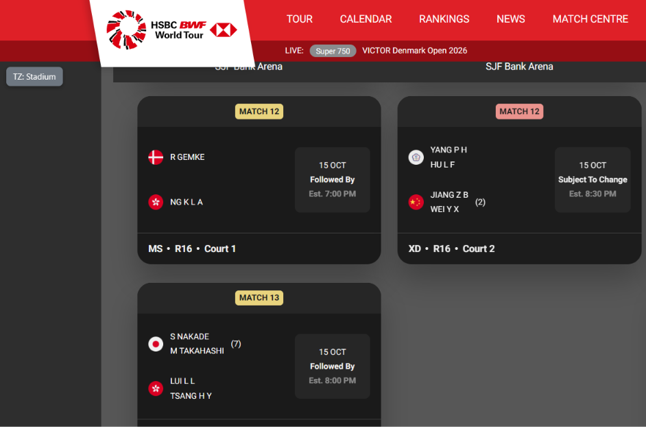
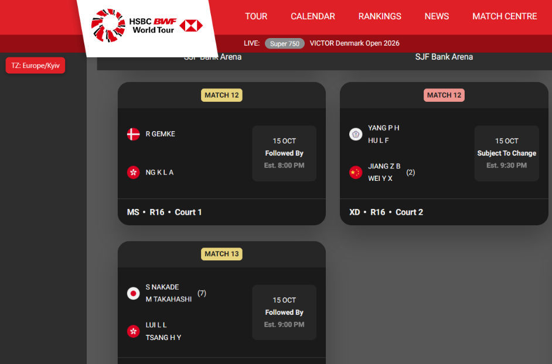

# BWF World Tour — local match times

A userscript for [bwfworldtour.bwfbadminton.com](https://bwfworldtour.bwfbadminton.com/) that shows
match start times in **your** timezone instead of the tournament (stadium) local time.

| Before — stadium time (Denmark, CET) | After — your time (here Europe/Kyiv, +1 h) |
| :---: | :---: |
|  |  |

## How it works

The schedule on a tournament's `results/<date>` page is loaded from
`https://extranet-lv.bwfbadminton.com/api/tournaments/day-matches`. Each match there has both
`matchTime` (stadium time, which the site displays) and `matchTimeUtc`. The script intercepts that
response and replaces `matchTime` with `matchTimeUtc` converted to your browser's timezone, so the
site's own widget renders correct times. The original value is kept as `matchTimeStadium`.

## Installation

1. Install a userscript manager: [Tampermonkey](https://www.tampermonkey.net/) or
   [Violentmonkey](https://violentmonkey.github.io/).
2. Open **[bwf-localtime.user.js (raw)](https://raw.githubusercontent.com/dfilippovsky/bwf-localtime/master/bwf-localtime.user.js)**
   — the manager will offer to install it. Click *Install*.
3. Open any tournament results page, e.g.
   `https://bwfworldtour.bwfbadminton.com/tournament/5210/victor-denmark-open-2026/results/2026-10-15`.

The script declares `@updateURL`/`@downloadURL`, so the manager picks up new versions automatically.

> Chrome/Edge: Tampermonkey requires *Allow User Scripts* (or Developer mode) to be enabled
> in the extension settings.

> Violentmonkey: the script declares `@inject-into page`, because it must patch the page's own
> `XMLHttpRequest`/`fetch`. If the badge stays `TZ: n/a` on a schedule page, check that the
> script's injection mode isn't overridden to *content* in Violentmonkey's settings.

## Usage

- A badge in the top-left corner (just below the red site header) shows which time is displayed:
  `TZ: Europe/Kyiv` or `TZ: Stadium`. Click it to switch.
- If a match falls on a different day in your timezone than at the stadium, its time gets a small
  `+1` (or `−1`) mark; hover it to see the local date. Typical for tournaments in the Americas
  watched from Europe.
- The site's own **Stadium Time / Your Time** buttons (which do nothing on the original site)
  also switch the mode.
- The choice is stored in `localStorage` (`bwfLocalTime.mode`).
- Badge states:
  - `TZ: Europe/Kyiv` (red) — times are converted.
  - Dimmed badge — no schedule has been loaded on this page yet (normal on non-schedule pages).
  - `TZ: Europe/Kyiv ⚠` (amber) — some matches had no UTC time and still show stadium time;
    hover the badge to see how many.
  - `TZ: n/a` (amber) — the schedule couldn't be converted: the BWF API answered in an unexpected
    format, or on a `results/<date>` page no schedule request was intercepted within 15 s. The script
    then leaves the response untouched, so the page shows the original stadium times and keeps working.

## Limitations

- Only the day schedule (`results/<date>`) is converted. Other pages that show times are left as is.
- The date tabs at the top are still stadium dates; use the `+1`/`−1` marks to spot matches that
  fall on another day in your zone.
- `extranet-lv.bwfbadminton.com` is an undocumented internal API and may change without notice.

## License

[MIT](LICENSE)
